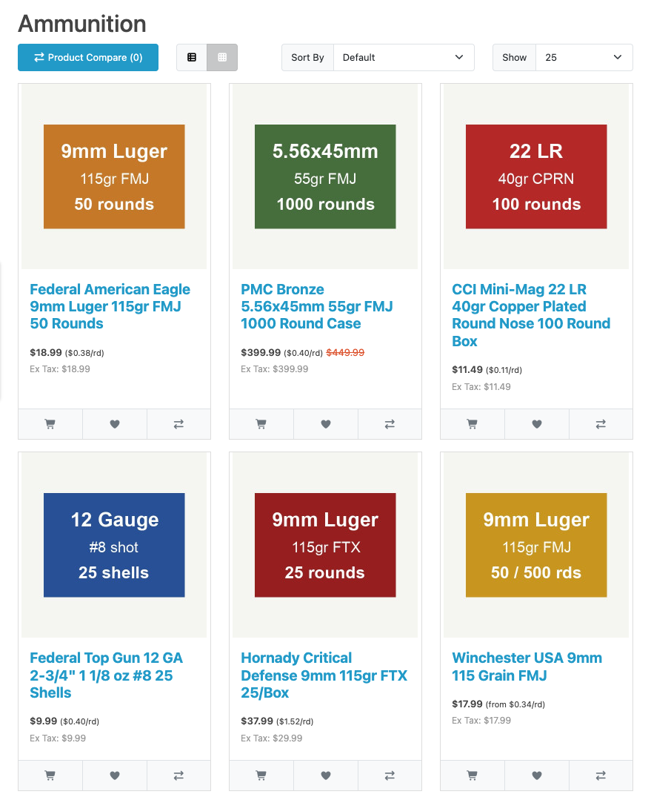

# Ammo Cost per Round & Firearm Specs for OpenCart

A free OpenCart extension for gun and ammunition stores. It shows the cost per round of ammunition next to the
price, and a short specs block (caliber, magazine capacity, barrel length) on firearm product pages. Both are read
from the product name, so there is nothing to fill in by hand.

| Product name | Price | The extension shows |
|---|---|---|
| Federal American Eagle 9mm Luger 115gr FMJ 50 Rounds | $18.99 | $18.99 ($0.38/rd) |
| PMC Bronze 5.56x45mm 55gr FMJ 1000 Round Case | $399.99 | $399.99 ($0.40/rd) |
| Federal Top Gun 12 GA 2-3/4" 1 1/8 oz #8 25 Shells | $9.99 | $9.99 ($0.40/rd) |
| Glock 19 Gen 5 9mm 4.02" 15rd Pistol | $549.00 | Caliber 9×19mm Parabellum, Capacity 15 rounds, Barrel length 4.02 in |

Two builds, both installed with **Extensions > Installer**:

- `gunsnprices_cpr.ocmod.zip` for OpenCart 4.0.2.3 and 4.1.0.x (tested on 4.0.2.3, 4.1.0.0 and 4.1.0.4)
- `gunsnprices_cpr_oc3.ocmod.zip` for OpenCart 3.0.4.x and 3.0.5.x (tested on 3.0.4.1 and 3.0.5.1)

The extension uses OpenCart events only. It does not change core files and has no OCMOD modifications, so there is
nothing to refresh under Extensions > Modifications.

It is built on the open source title parser of [GunsNPrices](https://gunsnprices.com), a price comparison site for
US gun and ammo stores. The parser runs on your server. The extension makes no requests to other sites, has no
tracking, and adds no links to your store unless you turn on the caliber links (off by default).




## Features

- **Cost per round** on product pages and in product lists: category, search, specials and brand pages, related
  products, and the product modules (Featured, Latest, Bestsellers, Specials).
- Uses the price the shopper sees: the special price when there is one, with or without tax as set in
  System > Settings > Option > "Display Prices With Tax", converted and formatted in the shopper's currency.
- Format: `$0.38/rd` or `$0.38 per round`, after the price or on its own line, with the currency's decimal places or
  one more (`$0.385`).
- The round count comes from the product name, from a product attribute you choose (`50`, `1,000`, `50 Rounds`), or
  from a product option you choose. With an option such as "Box size: 50 Rounds / 500 Rounds", every option value
  shows its own cost per round (`500 Rounds – $0.34/rd (+$150.00)`) and lists show the lowest (`from $0.34/rd`).
- **Firearm specs** on product pages: caliber, magazine capacity and barrel length, as a group in the Specification
  tab or as a table at the top of the description. Specs the product already has as attributes with the same name
  (for example "Caliber") are not repeated.
- Ammunition and firearms are recognized from the product name, or by category if you prefer.
- **Multi-store**: the default store's settings apply to every store; any store can have its own.
- "Try a product name" box on the settings page shows what the extension reads from a name.
- Optional links from caliber names to their price comparison pages on GunsNPrices.com, off by default.


## Requirements

- OpenCart 4.0.2.3 or 4.1.0.0 to 4.1.0.4, PHP 8.1 or later; or OpenCart 3.0.4.0 to 3.0.5.1, PHP 7.4 or later.
- The PHP `json` and `pcre` extensions (part of every OpenCart install). `mbstring` is used when present.


## Installation

### OpenCart 4

1. Go to **Extensions > Installer**, click **Upload** and choose `gunsnprices_cpr.ocmod.zip`.
   Do not rename the file: OpenCart 4 names the extension folder after it.
2. In the list below, click the green **Install** button next to "Ammo Cost per Round & Firearm Specs".
3. Go to **Extensions > Extensions**, choose **Modules**, find "Ammo Cost per Round & Firearm Specs", click
   **Install**, then **Edit**.
4. Turn on **Status** and click **Save**.

### OpenCart 3.0

1. Go to **Extensions > Installer**, click **Upload** and choose `gunsnprices_cpr_oc3.ocmod.zip`.
2. Go to **Extensions > Extensions**, choose **Modules**, find "Ammo Cost per Round & Firearm Specs", click
   **Install**, then **Edit**.
3. Set **Status** to Enabled and click **Save**.

The extension needs no other setup. It is not a layout module, so do not add it to a layout.


## Settings

**Settings for store.** Settings saved for the Default store apply to every store. Choose another store to give it
its own settings; "Use default store settings" removes them again.

**Cost per round**

| Setting | Choices |
|---|---|
| Show on product pages | on (default) / off |
| Show in product lists | on (default) / off |
| Position | After the price: `$21.99 ($0.44/rd)` (default) / On its own line below the price / Do not change the price |
| Format | `$0.38/rd` (default) / `$0.38 per round` |
| Decimal places | Same as the currency (default) / One more decimal place |
| Read the round count from | Product name (default) / Product attribute / Product option |
| Which products are ammunition | Guess from the product name (default) / Products in the chosen categories and their subcategories |

When the round count is read from an attribute or an option and a product has none, the product name is read.

Guessing works for names with a bullet weight (`115gr`), "ammo", "cartridges", "box of", "/box", or shotgun shell
words ("shells", "buck", "slug") together with a round count. A pistol named "Glock 19 9mm 15rd" is not mistaken for
a box of 15 rounds. If your product names are short, such as "9mm 50rd", choose categories instead.

**Firearm specs**

| Setting | Choices |
|---|---|
| Show firearm specs | on (default) / off |
| Position | Specification tab (default) / Top of the product description |
| Specs to show | Caliber, Capacity, Barrel length |
| Which products are firearms | Guess from the product name (default): names with a caliber that do not read like ammunition / Products in the chosen categories |
| Link calibers to GunsNPrices.com | off (default) / on |

With the default guessing, magazines and barrels with a caliber in their name get specs too. Use categories to limit
the block to firearms.


## How the cost per round is calculated

The price shown on the page (special price if there is one, otherwise the regular price, as OpenCart's own template
shows it) is divided by the number of rounds. Taxes are applied the same way OpenCart applies them to the displayed
price, so with "Display Prices With Tax" on, the cost per round includes tax. The result is converted to the
shopper's currency and formatted by OpenCart's currency formatter.

For an option value the price is the product price plus or minus the option value's price, as in the cart. Option
values that are out of stock (and subtract stock) are skipped.

If customers must log in to see prices, no cost per round is shown to visitors who are not logged in.


## For theme developers

The extension changes the `price` (or `special`) string that OpenCart passes to its templates, so it works with
themes that print `{{ price }}` and `{{ product.price }}`. It also sets:

- `{{ gnp_cost_per_round }}` on the product page and `{{ product.gnp_cost_per_round }}` in lists
  (OpenCart 3; in OpenCart 4 the product box template `product/thumb` gets `{{ gnp_cost_per_round }}`): plain text
  such as `$0.38/rd`. With Position set to "Do not change the price", only these variables are set.
- `gnp_specs` on the product page: the spec rows (`label`, `value`).

HTML classes: `gnp-cpr` (and `gnp-cpr-below` on its own line) for the cost per round, `gnp-specs` for the table at
the top of the description. The cost per round has small inline styles (font size, normal weight) that you can
override with `!important` in your theme's CSS.

Texts are in the language files `catalog/language/en-gb/.../gunsnprices_cpr.php` (keys start with `gnp_cpr_`). Copy
the file into another language folder to translate it; when a language has no file, the English texts are used.


## What it changes in the database

- Settings under the code `module_gunsnprices_cpr` (per store).
- Events with codes starting with `gunsnprices_cpr_` (3 on OpenCart 4, 10 on OpenCart 3), shown under
  Extensions > Events.

Uninstalling the module removes both. Removing the package in Extensions > Installer removes the files. Product data
is never changed.


## Accuracy

The parser was measured on 63,755 gun and ammo listings from 40+ US stores. When the name contains the value, it is
right 94 to 98% of the time: rounds per box 96.6%, caliber 97.8% for firearms, magazine capacity 95.6%, barrel length
94.4%. Many names do not mention the caliber or the barrel length; then nothing is shown for that spec. Details are
in the [library README](https://github.com/gunsnprices/gunsnprices-php#accuracy).

Names in English from US retailers work best.


## Troubleshooting

- **No cost per round on an ammo product.** Check the name in the "Try a product name" box on the settings page.
  The name needs a round count ("50 Rounds", "Box of 20", "20rds", "25/Box"). If the name is short, choose
  "Products in the chosen categories" or read the count from an attribute.
- **A cost per round on a product that is not ammunition.** Choose "Products in the chosen categories" for
  ammunition.
- **Nothing changes on the store front.** Check that Status is on for the store you are looking at, and that the
  events starting with `gunsnprices_cpr_` are enabled under Extensions > Events. Clear your theme's cache if it has
  one.
- **OpenCart 4: "Directory already exists" or a broken install.** The zip file was renamed. Upload it as
  `gunsnprices_cpr.ocmod.zip`.


## Building from source

```bash
php tools/vendor-parser.php ../gunsnprices-php   # bundle the parser (namespace renamed)
php tools/build.php                              # dist/gunsnprices_cpr.ocmod.zip and dist/gunsnprices_cpr_oc3.ocmod.zip
php tests/run.php                                # tests, no Composer needed
```

Layout: `shared/` is the code both builds share (cost per round, specs, settings, the bundled parser), `oc4/` and
`oc3/` are the OpenCart-specific controllers, templates and language files.


## License

GPL-3.0-or-later, see [LICENSE](LICENSE). Copyright 2026 GunsNPrices.

The extension bundles the gunsnprices PHP library 0.1.0 ([source](https://github.com/gunsnprices/gunsnprices-php),
Packagist `gunsnprices/gunsnprices`) in `system/library/gunsnprices_cpr/vendor/gunsnprices/`, with its namespace
renamed so it cannot clash with another copy. Its code is under the MIT License and its model and caliber data
(`data/models.json`, `data/calibers.json`) are © GunsNPrices (https://gunsnprices.com) under CC BY 4.0. Both are
compatible with the GPL; their license files are included.

Questions and corrections: app@gunsnprices.com or the
[issue tracker](https://github.com/gunsnprices/opencart-gunsnprices/issues).
